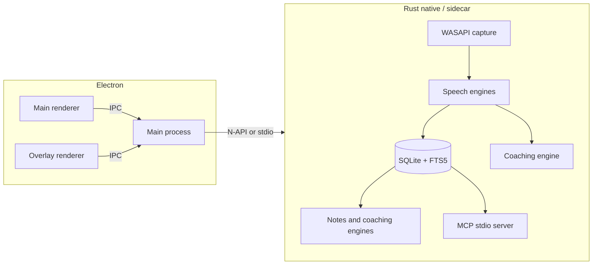

# annotated build plan

**Status:** canonical. Supersedes `docs/PRODUCT.md` and `docs/ARCHITECTURE.md`.

Windows-first, local-first AI meeting notepad. MeetMouse-class privacy and live coaching; a few Granola-easy extras (especially MCP). No meeting bot. A signed installer from annotated.click, and a $35 one-time unlock. Not the Microsoft Store.

---

## 1. Product scope & non-goals

### Positioning

**annotated** lives at [annotated.click](https://annotated.click). Leave the call with notes, owners, and next steps. Private by default, optional BYOK when you want a bigger model. Captures system/meeting audio on the machine, transcribes and summarizes on-device, nudges during the call. No meeting bot.

### In scope (v1 product)

- Windows desktop app (primary), distributed as a signed NSIS installer from annotated.click. Not the Microsoft Store.
- System / meeting audio capture without joining Zoom, Meet, Teams, or other calls as a bot.
- Speech-to-text chosen by the user: a local module downloaded from the app, a cloud speech API, or an external dictation app (Willow Voice and the rest). The default is on-device.
- Local LLM summaries, takeaways, and action items, or a cloud lab for text. Cloud notes see the transcript, not the audio, unless speech is also a cloud engine.
- In-app Dictate. Hold to talk inside annotated with the same speech engine used on the call. External apps hand off text; they keep the microphone.
- Per-meeting notes, searchable history, and ask-the-meeting chat with transcript timestamp citations.
- Live coaching overlay mid-call (talk ratio, stacked questions, missing dates/next steps, interruptions), screen-share safe.
- No account required for core local mode. Coaching and Markdown export are a $35 one-time payment, checked on this PC.
- Local MCP server so other AI tools can read curated notes and search meetings.
- MVP share: copy / export Markdown. Encrypted expiring links deferred (needs hosting).

### Non-goals (for now)

- Cloud account required to take notes.
- Meeting bot / guest participant in Zoom / Meet / Teams.
- Mac or Linux as a v1 shipping target.
- Team dashboards, org admin, or multi-user sync.
- Delivery / filler-word coaching (MeetMouse-adjacent but out of MVP cue set).
- Shipping or porting decompiled competitor code (clean-room behavior specs only).
- Continuing the disposable Vite/React SPA as the product architecture (rebuild a thin Electron renderer; do not evolve the scaffold feature-by-feature).
- Literal “REST API product shell” as the app (optional localhost HTTP only if tooling needs it later).
- Always-on cloud share backend or hosted encrypted links in MVP.
- Tauri (rejected after prior build friction; Electron is the shell).
- Microsoft Store, Partner Center, MSIX Store packages, and Microsoft checkout.

### Behavior specs from disposable TS stubs

Domain shapes in the current scaffold are **specs only** — do not port the React SPA:

| Spec | Intent |
| --- | --- |
| Meeting status: `draft` / `live` / `processing` / `ready` | Meeting lifecycle |
| Action items: text, owner, due | Next-steps extraction |
| Notes: summary, takeaways, raw Markdown | Post-call output |
| Speech, writer, and coach are module ids from `native/catalog/providers.json` | Privacy follows the module: local, cloud, external handoff, or rules |
| Coaching cue kinds: `talk-ratio`, `stacked-questions`, `no-date`, `no-next-steps`, `interrupt` | Overlay cues |
| Audio: PCM chunks + sample rate + capture adapter surface | Capture pipeline contract |

---

## 2. Recommended architecture

### Stack interpretation (“REST app”)

User ask for a “REST app” for speed + native Windows means **desktop-native performance for capture/inference**, not a browser SPA with a REST façade and not a literal REST API product.

**Locked choice (revised):** **Electron + thin renderer + Rust native module/sidecar for the hot path.**

Electron is the more mature, better-documented Windows desktop shell (windowing, overlay, NSIS packaging, Credential Manager from main). Tauri was preferred earlier for binary size; it is **out** after repeated local build friction. Speed still comes from Rust (or C++) for WASAPI / Whisper / llama.cpp — not from doing inference in the renderer.

| Role | Owns |
| --- | --- |
| Electron main | App lifecycle, main + overlay `BrowserWindow`s, `setContentProtection`, installer packaging, DPAPI/Credential Manager, IPC hub |
| Thin renderer | Meetings, notes, settings, ask-chat, overlay cue UI — command/query via preload IPC; not a growing SPA feature tree |
| Rust native / sidecar | WASAPI capture, Whisper STT, local LLM, SQLite+FTS5 (preferred next to the audio pipeline), coaching engine, MCP stdio server |
| Not chosen | Tauri; shipping/evolving the current Vite SPA as-is; pure egui/iced; “React SPA + local REST” as the product |

### Desktop shell

- **Electron** on Windows (bundled Chromium — no WebView2 bootstrapper dependency).
- Main window for meetings, notes, settings, ask-chat.
- Separate always-on-top overlay `BrowserWindow` for coaching cues; `setContentProtection(true)` maps to exclude-from-capture behavior — **re-apply after hide/show**.
- Heavy work stays out of the renderer: Rust N-API addon and/or long-lived sidecar process spoken to from main.
- Renderer stays thin; rebuild under Electron rather than carrying the disposable Vite scaffold forward.

### Audio

- **WASAPI shared-mode loopback** on the default render device (`cpal` and/or `wasapi` crate).
- Optional **mic mix** for the user’s own speech when loopback alone is weak.
- **Process loopback** (Zoom / Teams / browser PID targeting) deferred as a quality fallback, not MVP-blocking.
- Never inject a call participant; capture is local OS audio only.
- Handle device switches and exclusive-mode apps as explicit error / “retry capture” UX.

### Speech

The catalog is `native/catalog/providers.json`. One speech module serves the live call and in-app Dictate.

- **On this PC (default):** Whisper via whisper.cpp (Tiny, Base, Small, Large v3 Turbo) and sherpa-onnx modules (Moonshine, Parakeet TDT v3, SenseVoice, Zipformer streaming, Nemotron streaming). Files download into `%LocalAppData%\CrunchCall\models`. Audio stays on the machine. The first build stores and downloads them; linking whisper.cpp and sherpa-onnx is the next native step, and the app says so instead of inventing a transcript.
- **Cloud, opt-in:** OpenAI, Groq, Deepgram, AssemblyAI, ElevenLabs Scribe, Mistral Voxtral, Fireworks, and Gemini audio. Azure, Gladia, Speechmatics, Rev, and Soniox are listed until their clients land. Picking one sends audio to that lab. The settings line says so.
- **Another app:** Willow Voice, Wispr Flow, Superwhisper, Aqua Voice, Handy, Wspr, Windows voice typing, Windows Voice Access. annotated does not call their private APIs. The user dictates there and pastes the text into Dictate. annotated stores the text and can still write the notes.

### Notes and coaching

- **Local writers:** llama.cpp GGUF modules, small on purpose (Qwen2.5 0.5B / 1.5B / 3B, SmolLM2 1.7B, plus Llama 3.2, Gemma, Phi-4 mini, Granite when the file is available). Default is Qwen2.5 1.5B. Wi-Fi-off path remains capture → local speech → local notes.
- **Cloud writers, text only:** Anthropic Claude Haiku, OpenAI mini, Gemini Flash, xAI Grok, Groq, DeepSeek, Mistral, Cohere, Fireworks, Together, Cerebras, and OpenRouter. The model id is editable. They receive the transcript, not the audio, unless speech is also cloud.
- **Coaching:** the five cues run on-device with no model. Tiny wording packs (Crisp, Manager, Sales, Interview) ship inside the app. Optional: the notes model phrases the cue, and only the cue text leaves if that model is cloud.
- Keys live in Windows Credential Manager. SQLite stores the target name, never the key.

### Dictate

- A primary screen, hold to talk, same speech module as the call.
- Local and cloud engines capture the mic in the app and hand PCM to `crunchcalld`.
- External engines do not capture. The screen shows that app's hotkey and a paste field.

### Overlay (screen-share safe)

- Separate **always-on-top** window for cues.
- Apply **`set_content_protected` / `WDA_EXCLUDEFROMCAPTURE`**; **re-apply after every hide/show** (affinity can reset).
- Cue kinds (MVP set): talk ratio, stacked questions, no date, no next steps, interrupt.
- QA matrix against Zoom, Meet, and Teams share (invisible vs black rectangle vs leak). Treat failures as release blockers for coaching.

### Storage

- **SQLite** (`rusqlite`) + **FTS5**.
- Entities: meetings, utterances (text + timestamps), notes, action items, coaching cues, ask-chat threads.
- Path under app data (e.g. `%LocalAppData%\CrunchCall\`); no cloud sync in core local mode.
- Replace the scaffold’s `localStorage` entirely.

### MCP

- Local **stdio MCP server** (Rust MCP SDK / `rmcp`), in-process sibling or companion binary.
- Tools: list meetings, search notes/transcripts (FTS), read curated notes + transcript excerpts.
- Local-only; document Cursor / Claude Desktop config snippets.
- **Never** expose BYOK secrets or raw audio over MCP.

### Share

- **MVP:** copy Markdown / export `.md` of curated notes (not full transcript/coaching dump by default).
- **Deferred:** encrypted expiring links (needs minimal hosting) — Phase 5+.

### Monetization

- **$35 one-time payment** at [annotated.click/buy](https://annotated.click/buy). No subscription and no Microsoft checkout.
- The desktop app stores the license on this PC and checks it offline.
- Core local mode works offline with **no login**. Coaching and Markdown export are the unlock.

---

## 3. Feature matrix

Priority: **P0** MVP / ship baseline · **P1** near-term differentiators · **P2** polish.  
Effort: **S** small · **M** medium · **L** large.

### MeetMouse parity

| Feature | Priority | Effort | Notes |
| --- | --- | --- | --- |
| System / meeting audio capture, no bot | P0 | M | WASAPI loopback; mic mix optional |
| Speech module picker: local download, cloud API, or external dictation app | P0 | L | Catalog in `native/catalog/providers.json`. Default Whisper Tiny |
| In-app Dictate with the same speech module | P0 | M | Hold to talk. External apps hand off text |
| Local summaries, takeaways, next steps + owners | P0 | M | Small local instruct model, default Qwen2.5 1.5B |
| Cloud notes labs (text) and cloud speech (audio, separate opt-in) | P0 | M | Credential Manager. Many labs, editable model id |
| Per-meeting notes + ask-the-meeting with timestamp citations | P0 | M | SQLite + chat over transcript |
| No account for core; $35 one-time unlock | P0 | S | License checked on this PC |
| Live coaching overlay (cue set + share-safe) | P1 | M | After capture+STT solid |
| Curated share (export first; links later) | P2 | S–M | Markdown MVP; links deferred |
| Process-targeted loopback | P2 | L | Fallback for hard call apps |

### Granola-easy extras (effort-ordered)

| Feature | Priority | Effort | Notes |
| --- | --- | --- | --- |
| MCP notes access | P1 | M | High leverage for AI-tool users |
| Cross-meeting memory search / ask-all | P1 | M | FTS5 + chat across meetings |
| Calendar brief (Outlook / ICS) | P2 | L | Graph consent friction |
| Polished share UX | P2 | M | After export works |

---

## 4. Installer and distribution

The app is not on the Microsoft Store. There is no Partner Center listing, no MSIX Store package, and no Microsoft checkout.

### Installer

- **electron-builder** NSIS, one-click, per user (`electron-builder.yml`).
- Chromium ships with Electron. No WebView2 bootstrapper.
- Authenticode-sign the installer. `electron-updater` rejects an update whose publisher does not match this build.
- People download it from annotated.click. GitHub is the update feed.

### Package size and models

- Ship a small default model, or download it on first run into `%LocalAppData%\CrunchCall\models`.
- Say the download size, and what still works offline, in the first-run UI.

### Monetization

- **$35 once**, paid at annotated.click/buy. No subscription.
- License check only for the paid unlock. Local notes do not need an annotated account.

---

## 5. Phased roadmap

### Phase 1 — MVP

- Electron main + preload + thin renderer; Rust native/sidecar skeleton (no Vite SPA carryover).
- WASAPI shared-mode loopback (+ optional mic).
- Speech catalog → timestamped utterances in SQLite. Default Whisper. Cloud and external handoff are selectable.
- In-app Dictate on the same speech module.
- Local LLM summary / takeaways / action items, with optional cloud writers.
- Meeting list, live session, post-call notes view.
- Offline-capable happy path.

### Phase 2 — Installer

- Signed NSIS installer and the update feed.
- Privacy copy and model download UX.
- $35 unlock wired to the on-PC license check.

### Phase 3 — Coaching

- Overlay window, cue engine (five kinds), content-protection hardening.
- Re-apply `WDA_EXCLUDEFROMCAPTURE` after hide/show.
- Share QA matrix for Zoom / Meet / Teams.

### Phase 4 — MCP

- Stdio MCP server: list / search / read notes and excerpts.
- Docs for Cursor and Claude Desktop.
- Cross-meeting FTS search / ask-all.

### Phase 5 — Polish

- Calendar brief, richer export/share UX.
- Process loopback targeting.
- BYOK polish; deferred encrypted link share if hosting exists.
- Performance pass on dual STT+LLM memory.

---

## 6. Risks

| Risk | Impact | Mitigation |
| --- | --- | --- |
| Loopback quality, device switches, exclusive-mode apps | Missed audio / bad transcripts | Clear device UX; mic mix; later process loopback |
| Overlay affinity resets; black rectangle in some shares | Coaching leaks or ugly share | Re-apply protection; QA matrix; fail closed (hide overlay) |
| Dual Whisper + local LLM RAM/disk on low-end PCs | Crashes / slow machines | Small models; sequential inference options; documented minimums |
| Background capture, AI, and network surprise people | Trust and support load | Honest privacy copy; BYOK and network only when opted in |
| Share-links need a backend | Scope creep vs local-core promise | Export-only until hosting is intentional |
| MCP surface + BYOK keys | Secret leakage | No secrets over MCP; DPAPI only |
| Model download / license compliance | Legal problem | Prefer redistributable or user-download models; document licenses |
| Electron installer / RAM weight vs Tauri | Larger installer; heavier idle footprint | First-run models; sequential inference; trim unused Chromium features where safe |
| Thin UI scope creep into a fat renderer SPA | Wrong architecture | Keep main+preload IPC-first; Rust owns hot path |

---

## 7. What to delete / replace from the current Vite scaffold

Treat the current Vite/React app as **disposable**. Implementation work starts by replacing it, not evolving it.

### Delete or stop depending on (when implementation begins)

- Scaffold `src/` React app as the product root (`App.tsx`, feature runtime, `localStorage` store) — do not evolve it into Electron.
- Standalone Vite-only entry wiring that assumes a browser SPA (keep Vite only if reused as the Electron renderer bundler under a new layout).
- `dist/` browser build output; `src/lib/storage.ts` (`localStorage`) — replaced by SQLite in the native/main layer.
- Stub providers in `src/features/llm/providers.ts` as runnable code (keep ideas only as specs above).

### Keep as prose / brand (not as architecture)

- Positioning and north star in `README.md` (rewrite to Electron + Rust native workflow when coding starts).
- Cue kinds, meeting statuses, LLM modes — already captured in this plan as behavior specs.
- Clean-room rule: competitor research stays in specs; implementation is original.

### Replace with (implementation — not this docs task)

- Electron app layout: `electron/` (main + preload), thin `renderer/` (or equivalent), `native/` or `crates/` Rust workspace (audio, stt, llm, db, coach, mcp).
- IPC contracts from renderer → main → Rust; overlay as a second `BrowserWindow`.
- This file (`docs/PLAN.md`) as the architecture and roadmap canon.
- electron-builder NSIS config when Phase 2 starts. The Microsoft Store is not a packaging target.

---

## Locked decisions (do not reopen)

1. **Stack:** Electron + thin renderer + Rust native/sidecar for capture/STT/LLM — not Tauri, not evolving the Vite SPA as-is, not a REST API product shell.
2. **Audio:** WASAPI shared-mode loopback (`cpal`/`wasapi`); optional mic mix; process loopback later.
3. **Speech:** One module for the call and for Dictate. Default is on-device Whisper under `%LocalAppData%\CrunchCall\models`. The catalog also offers other local engines, opt-in cloud speech, and external dictation apps that only hand off text.
4. **Notes:** llama.cpp by default (small GGUF, Wi-Fi-off path). Cloud labs are opt-in for text. Coaching cues run on-device; wording packs are local; the notes model may phrase a cue.
5. **Keys:** Windows Credential Manager / DPAPI. A cloud speech module is the only way audio leaves the PC, and the UI says when it does. Cloud notes never receive audio unless speech is also cloud.
6. **Overlay:** Separate always-on-top window + content protection; re-apply after hide/show.
7. **Storage:** SQLite + FTS5.
8. **MCP:** Local stdio MCP for notes/search/read.
9. **Share:** MVP copy/export Markdown; encrypted expiring links deferred.
10. **Distribution:** Signed NSIS installer from annotated.click. Not the Microsoft Store, not MSIX, not Microsoft checkout.
11. **Monetization:** $35 one-time unlock at annotated.click/buy, checked on this PC. No account for core local mode.
